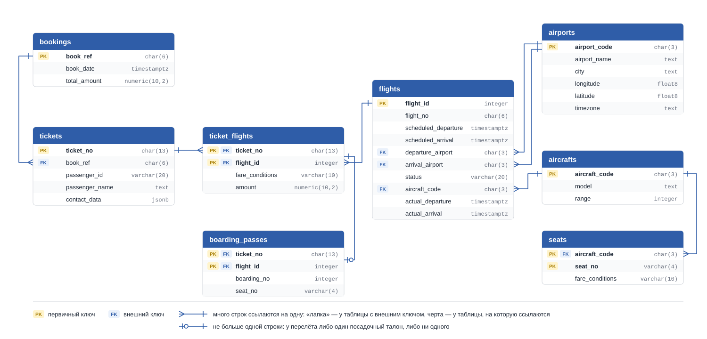
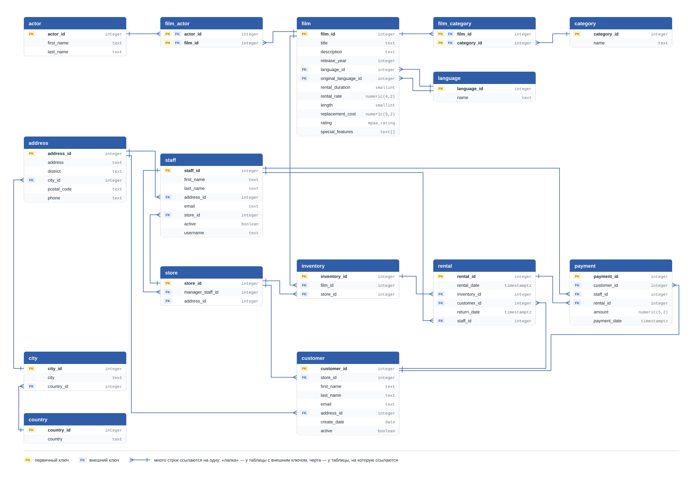
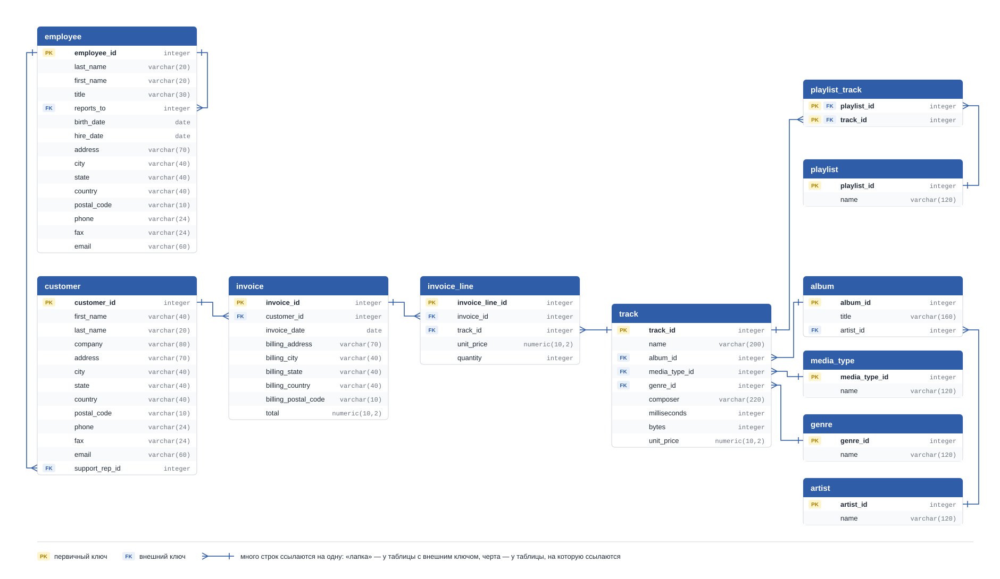

# Учебные базы

Все учебные данные лежат в одной базе `hse_databases`, каждый набор — в своей схеме. В запросах
имя таблицы пишется вместе со схемой: `bookings.flights`, `film_rental.film`.

| Схема | Предметная область | Таблиц |
|---|---|---|
| [`bookings`](#авиаперевозки--схема-bookings) | авиаперевозки | 8 |
| [`film_rental`](#прокат-фильмов--схема-film_rental) | прокат фильмов | 15 |
| [`music_store`](#магазин-цифровой-музыки--схема-music_store) | магазин цифровой музыки | 11 |

Схемы всех трёх баз и сводка по ним — в [`databases.pdf`](databases.pdf).

## Авиаперевозки — схема `bookings`

Демобаза Postgres Pro, загружена без изменений. Схема построена по самой базе: столбцы, типы
и ключи — такие же, какие вы увидите в DBeaver.

### Как читать схему

- **Блок** — таблица, строки внутри — её столбцы: слева пометка ключа и имя, справа тип.
- **PK** — первичный ключ: по нему строка отличается от остальных. Если пометка PK стоит
  у нескольких столбцов, ключ составной: уникальна их комбинация, а не каждый по отдельности.
- **FK** — внешний ключ: значение этого столбца обязано существовать в другой таблице.
- **Линия** идёт от столбца с внешним ключом к столбцу, на который он ссылается. «Лапка» стоит
  у таблицы, где строк много, черта — у таблицы, где строка одна. Например, `tickets → bookings`:
  у билета ровно одно бронирование, в бронировании может быть много билетов.
- **Две линии от `flights` к `airports`**: у рейса два аэропорта — вылета и прилёта, и каждый
  столбец ссылается на `airports` отдельно.
- **Линия от `boarding_passes` к `ticket_flights`** соединяет сразу пару столбцов
  (`ticket_no`, `flight_id`): внешний ключ составной.
- Все столбцы обязательные (`NOT NULL`), кроме трёх: `tickets.contact_data`,
  `flights.actual_departure` и `flights.actual_arrival`.

Типы на схеме записаны коротко: `char(3)` — это `character(3)`, `varchar` — `character varying`,
`timestamptz` — `timestamp with time zone`, `float8` — `double precision`.

### Что означает одна строка

| Таблица | Одна строка — это | Строк |
|---|---|---|
| `bookings.bookings` | бронирование: одна покупка, в которой один или несколько билетов | 262 788 |
| `bookings.tickets` | билет одного пассажира | 366 733 |
| `bookings.ticket_flights` | перелёт по билету на конкретном рейсе: в билете с пересадкой их несколько | 1 045 726 |
| `bookings.boarding_passes` | посадочный талон: выдаётся при регистрации на рейс, поэтому есть не у каждого перелёта | 579 686 |
| `bookings.flights` | рейс в конкретный день: рейс `PG0405` за разные дни — разные строки | 33 121 |
| `bookings.airports` | аэропорт | 104 |
| `bookings.aircrafts` | модель самолёта (не отдельный борт) | 9 |
| `bookings.seats` | место в салоне модели самолёта | 1 339 |

### Что лежит в столбцах

| Таблица | Столбец | Что в нём |
|---|---|---|
| `bookings` | `book_ref` | номер бронирования |
| | `book_date` | когда оформлено |
| | `total_amount` | полная стоимость всех билетов бронирования |
| `tickets` | `ticket_no` | номер билета |
| | `book_ref` | бронирование, в которое входит билет |
| | `passenger_id` | номер документа пассажира |
| | `passenger_name` | имя и фамилия заглавными буквами |
| | `contact_data` | телефон и email, может быть `NULL` |
| `ticket_flights` | `ticket_no`, `flight_id` | билет и рейс |
| | `fare_conditions` | класс обслуживания |
| | `amount` | стоимость этого перелёта |
| `boarding_passes` | `ticket_no`, `flight_id` | билет и рейс |
| | `boarding_no` | номер посадочного талона на рейсе |
| | `seat_no` | место в салоне |
| `flights` | `flight_id` | номер строки рейса |
| | `flight_no` | номер рейса, например `PG0405` |
| | `scheduled_departure`, `scheduled_arrival` | вылет и прилёт по расписанию |
| | `departure_airport`, `arrival_airport` | аэропорты вылета и прилёта |
| | `status` | статус рейса |
| | `aircraft_code` | модель самолёта |
| | `actual_departure`, `actual_arrival` | фактические вылет и прилёт, могут быть `NULL` |
| `airports` | `airport_code` | код аэропорта из трёх букв |
| | `airport_name`, `city` | название и город |
| | `longitude`, `latitude` | долгота и широта |
| | `timezone` | часовой пояс аэропорта |
| `aircrafts` | `aircraft_code` | код модели |
| | `model` | название модели |
| | `range` | дальность полёта, км |
| `seats` | `aircraft_code`, `seat_no` | модель самолёта и номер места |
| | `fare_conditions` | класс обслуживания |

### Значения, которые стоит знать

- **`flights.status`** — `Scheduled` (продажа открыта), `On Time` (регистрация открыта, вылет вовремя),
  `Delayed` (вылет задержан), `Departed` (в воздухе), `Arrived` (прилетел), `Cancelled` (отменён).
- **`fare_conditions`** — `Economy`, `Comfort`, `Business`.
- **`tickets.contact_data`** — контакты пассажира в формате JSON: `{"email": "…", "phone": "…"}`.
  Поле достаётся так: `contact_data->>'email'`.
- Данные сформированы на момент **13.10.2016 17:00**: рейсы после этого момента ещё не состоялись.

Кроме таблиц, в схеме `bookings` есть два готовых представления — `flights_v` и `routes` (рейсы
и маршруты с названиями городов и аэропортов) — и функция `bookings.now()`, которая возвращает
момент, на который сформированы данные. Подробное описание — на сайте Postgres Pro:
<https://postgrespro.ru/education/demodb>.

## Прокат фильмов — схема `film_rental`

База Pagila — версия классической учебной базы Sakila для PostgreSQL. Сеть из двух пунктов
проката DVD: фильмы и их копии на дисках, клиенты, сотрудники, выдачи и платежи. Данные
за 24.05–23.08.2022. Как читать схему — см. [раздел про авиаперевозки](#как-читать-схему).

### Что важно на схеме

- **Связи «многие ко многим»** между фильмами и актёрами, фильмами и жанрами хранятся в отдельных
  таблицах `film_actor` и `film_category`: в каждой строке — пара «фильм — актёр» или
  «фильм — жанр», а первичный ключ — эта пара целиком.
- **Две линии от `film` к `language`**: у фильма есть язык (`language_id`) и язык оригинала
  (`original_language_id`), оба ссылаются на `language`.
- **`store` и `staff` ссылаются друг на друга**: сотрудник работает в пункте проката
  (`staff.store_id`), а у пункта есть управляющий из сотрудников (`store.manager_staff_id`).
- **Адреса — цепочкой** `address → city → country`. На `address` ссылаются клиенты, сотрудники
  и пункты проката.
- Обязательны все столбцы, кроме `film.description`, `release_year`, `original_language_id`,
  `length`, `rating`, `special_features`, `customer.email`, `staff.email`, `rental.return_date`
  и `address.district`, `postal_code`, `phone`.

Типы на схеме: `timestamptz` — `timestamp with time zone`, `text[]` — массив строк,
`mpaa_rating` — перечисление возрастных рейтингов.

### Что означает одна строка

| Таблица | Одна строка — это | Строк |
|---|---|---|
| `film_rental.film` | фильм | 1 000 |
| `film_rental.actor` | актёр | 200 |
| `film_rental.film_actor` | актёр, снявшийся в фильме | 5 462 |
| `film_rental.category` | жанр | 16 |
| `film_rental.film_category` | жанр фильма: у каждого фильма ровно один | 1 000 |
| `film_rental.language` | язык | 6 |
| `film_rental.inventory` | копия фильма (диск) в конкретном пункте проката | 4 581 |
| `film_rental.store` | пункт проката | 2 |
| `film_rental.staff` | сотрудник | 2 |
| `film_rental.customer` | клиент | 599 |
| `film_rental.rental` | выдача копии клиенту | 15 862 |
| `film_rental.payment` | платёж за выдачу: на каждую выдачу ровно один | 15 862 |
| `film_rental.address` | адрес клиента, сотрудника или пункта проката | 603 |
| `film_rental.city` | город | 600 |
| `film_rental.country` | страна | 109 |

### Что лежит в столбцах

| Таблица | Столбец | Что в нём |
|---|---|---|
| `film` | `film_id` | номер фильма |
| | `title` | название, заглавными буквами |
| | `description` | краткое описание сюжета |
| | `release_year` | год выхода |
| | `language_id`, `original_language_id` | язык фильма и язык оригинала |
| | `rental_duration` | на сколько дней выдаётся, от 3 до 7 |
| | `rental_rate` | цена выдачи: 0.99, 2.99 или 4.99 |
| | `length` | длительность, минуты |
| | `replacement_cost` | сколько клиент платит, если потеряет диск |
| | `rating` | возрастной рейтинг |
| | `special_features` | дополнительные материалы на диске — массив |
| `actor` | `actor_id`, `first_name`, `last_name` | номер, имя и фамилия актёра, заглавными буквами |
| `film_actor` | `actor_id`, `film_id` | актёр и фильм |
| `category` | `category_id`, `name` | номер и название жанра |
| `film_category` | `film_id`, `category_id` | фильм и жанр |
| `language` | `language_id`, `name` | номер и название языка |
| `inventory` | `inventory_id` | номер копии |
| | `film_id`, `store_id` | какой это фильм и в каком пункте проката лежит копия |
| `store` | `store_id` | номер пункта проката |
| | `manager_staff_id` | управляющий — сотрудник |
| | `address_id` | адрес пункта |
| `staff` | `staff_id`, `first_name`, `last_name` | номер, имя и фамилия сотрудника |
| | `address_id`, `email` | адрес и почта |
| | `store_id` | пункт проката, где он работает |
| | `active` | работает ли сейчас |
| | `username` | логин в системе проката |
| `customer` | `customer_id`, `first_name`, `last_name` | номер, имя и фамилия клиента, заглавными буквами |
| | `store_id` | пункт проката, к которому он прикреплён |
| | `email`, `address_id` | почта и адрес |
| | `create_date` | дата регистрации |
| | `active` | активен ли клиент |
| `rental` | `rental_id` | номер выдачи |
| | `rental_date` | когда диск выдан |
| | `inventory_id` | какая копия выдана |
| | `customer_id`, `staff_id` | кому выдана и кто выдал |
| | `return_date` | когда диск вернули, `NULL` — ещё не вернули |
| `payment` | `payment_id` | номер платежа |
| | `customer_id`, `staff_id`, `rental_id` | кто заплатил, кто принял платёж и за какую выдачу |
| | `amount` | сумма, от 0.99 до 11.99 |
| | `payment_date` | когда заплачено: совпадает с моментом выдачи |
| `address` | `address_id`, `address` | номер и адрес: дом и улица |
| | `district` | район или регион |
| | `city_id` | город |
| | `postal_code`, `phone` | индекс и телефон |
| `city` | `city_id`, `city`, `country_id` | номер, название города и его страна |
| `country` | `country_id`, `country` | номер и название страны |

### Значения, которые стоит знать

- **`film.rating`** — `G` (без ограничений), `PG`, `PG-13`, `R`, `NC-17` (только для взрослых).
  Это перечисление: значения сравниваются в этом порядке, а не по алфавиту.
- **`film.special_features`** — массив из значений `Trailers`, `Commentaries`, `Deleted Scenes`,
  `Behind the Scenes`. Проверить, есть ли значение в массиве: `'Trailers' = ANY (special_features)`.
- **`category.name`** — 16 жанров: `Action`, `Animation`, `Children`, `Classics`, `Comedy`,
  `Documentary`, `Drama`, `Family`, `Foreign`, `Games`, `Horror`, `Music`, `New`, `Sci-Fi`,
  `Sports`, `Travel`.
- Все фильмы — 2006 года и на английском: `original_language_id` везде `NULL`.
- В сети два пункта проката и два сотрудника: каждый сотрудник — управляющий своего пункта.
- Не вернули только одну копию; в прокате есть фильмы без копий и фильмы без актёров.
- В ноутбуке дата и время показываются по московскому времени.

Исходная база: <https://github.com/devrimgunduz/pagila>, лицензия PostgreSQL License. Для курса
убраны служебные столбцы и готовые представления, а дата платежа совпадает с датой выдачи.

## Магазин цифровой музыки — схема `music_store`

База Chinook: интернет-магазин, который продаёт треки. Сотрудники, покупатели, счета и строки
счетов, каталог музыки и плейлисты. Продажи за 2021–2025 годы. Как читать схему —
см. [раздел про авиаперевозки](#как-читать-схему).

### Что важно на схеме

- **Петля у `employee`**: столбец `reports_to` ссылается на ту же таблицу — это начальник
  сотрудника. Иерархию целиком собирает рекурсивный запрос.
- **Покупка — это счёт и его строки**: `invoice` — одна покупка, `invoice_line` — купленные
  в ней треки. Сумма счёта `invoice.total` равна сумме строк.
- **Связь «многие ко многим»** между плейлистами и треками хранится в таблице `playlist_track`.
- Обязательны ключи, имена людей, `customer.email`, дата и сумма счёта, название альбома и трека,
  формат файла трека, его длительность и цена. Остальное может быть `NULL`: адреса и контакты,
  должность, начальник и даты сотрудника, компания и сотрудник покупателя, альбом, жанр, автор
  и размер трека, названия исполнителей, жанров, форматов и плейлистов.

### Что означает одна строка

| Таблица | Одна строка — это | Строк |
|---|---|---|
| `music_store.artist` | исполнитель | 275 |
| `music_store.album` | альбом | 347 |
| `music_store.track` | трек | 3 503 |
| `music_store.genre` | жанр | 25 |
| `music_store.media_type` | формат файла | 5 |
| `music_store.playlist` | плейлист | 18 |
| `music_store.playlist_track` | трек в плейлисте | 8 715 |
| `music_store.employee` | сотрудник | 8 |
| `music_store.customer` | покупатель | 59 |
| `music_store.invoice` | счёт: одна покупка | 412 |
| `music_store.invoice_line` | строка счёта: один купленный трек | 2 240 |

### Что лежит в столбцах

| Таблица | Столбец | Что в нём |
|---|---|---|
| `artist` | `artist_id`, `name` | номер и имя исполнителя или название группы |
| `album` | `album_id`, `title` | номер и название альбома |
| | `artist_id` | исполнитель |
| `track` | `track_id`, `name` | номер и название трека |
| | `album_id`, `genre_id`, `media_type_id` | альбом, жанр и формат файла |
| | `composer` | автор музыки, может быть `NULL` |
| | `milliseconds` | длительность, миллисекунды |
| | `bytes` | размер файла, байты |
| | `unit_price` | цена: 0.99 или 1.99 |
| `genre` | `genre_id`, `name` | номер и название жанра |
| `media_type` | `media_type_id`, `name` | номер и название формата файла |
| `playlist` | `playlist_id`, `name` | номер и название плейлиста |
| `playlist_track` | `playlist_id`, `track_id` | плейлист и трек в нём |
| `employee` | `employee_id`, `first_name`, `last_name` | номер, имя и фамилия сотрудника |
| | `title` | должность |
| | `reports_to` | начальник — тоже сотрудник; `NULL` у директора |
| | `birth_date`, `hire_date` | дата рождения и дата найма |
| | `address`, `city`, `state`, `country`, `postal_code` | адрес |
| | `phone`, `fax`, `email` | телефон, факс и почта |
| `customer` | `customer_id`, `first_name`, `last_name` | номер, имя и фамилия покупателя |
| | `company` | компания, если покупатель от неё |
| | `address`, `city`, `state`, `country`, `postal_code` | адрес |
| | `phone`, `fax`, `email` | телефон, факс и почта |
| | `support_rep_id` | сотрудник, который обслуживает покупателя |
| `invoice` | `invoice_id` | номер счёта |
| | `customer_id` | покупатель |
| | `invoice_date` | дата покупки |
| | `billing_address`, `billing_city`, `billing_state`, `billing_country`, `billing_postal_code` | адрес в счёте на момент покупки |
| | `total` | сумма счёта |
| `invoice_line` | `invoice_line_id` | номер строки |
| | `invoice_id`, `track_id` | счёт и купленный трек |
| | `unit_price` | цена трека в момент покупки |
| | `quantity` | количество, везде 1 |

### Значения, которые стоит знать

- **`employee.title`** — должности: `General Manager` (директор), `Sales Manager`,
  `Sales Support Agent`, `IT Manager`, `IT Staff`. Иерархия в три уровня: директор → два
  руководителя → остальные. Покупателей обслуживают три сотрудника с должностью
  `Sales Support Agent`.
- **`media_type.name`** — `MPEG audio file`, `AAC audio file`, `Protected AAC audio file`,
  `Purchased AAC audio file`, `Protected MPEG-4 video file` (видео, в основном эпизоды сериалов).
- **Жанры** — 25 названий, в том числе `Rock`, `Jazz`, `Metal`, `Latin`, `Classical`, `TV Shows`.
- `customer.state` — штат или регион, заполнен у 30 покупателей из 59, у остальных `NULL`.
- Часть треков ни разу не продана; 4 плейлиста пустые, и у нескольких плейлистов совпадают названия.
- Первичные ключи нумеруются автоматически: в `INSERT` номер можно не указывать.

Исходная база: <https://github.com/lerocha/chinook-database>, лицензия MIT. Для курса даты
переведены в тип `date`, а ключам добавлена автонумерация.
